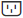

= SANtricity System Manager에서 선반 구성 요소의 상태 및 설정을 확인하세요.
:allow-uri-read: 
:experimental: 
:icons: font
:imagesdir: ../media/

[role="lead"]
하드웨어 페이지에서는 전원 공급 장치, 팬 및 배터리를 포함한 쉘프 구성 요소의 상태 및 설정을 제공합니다.

.이 작업 정보
사용 가능한 구성 요소는 쉘프 유형에 따라 다릅니다.

* *드라이브 셸프* -- 단일 셸프에 드라이브 세트, 전원/팬 캐니스터, 입출력 모듈(IOM) 및 기타 지원 구성 요소가 포함되어 있습니다.
* *컨트롤러 셸프* -- 드라이브 세트, 하나 또는 두 개의 컨트롤러 캐니스터, 전원/팬 캐니스터 및 기타 지원 구성 요소를 단일 셸프에 포함합니다.

.단계
. * Hardware * 를 선택합니다.
. 컨트롤러 셸프 또는 드라이브 셸프의 드롭다운 목록을 선택한 다음 *설정 보기*를 선택합니다.
+
Shelf Components Settings 대화 상자가 열리고 선반 구성 요소와 관련된 상태 및 설정을 보여주는 탭이 표시됩니다. 선택한 선반 유형에 따라 표에 설명된 일부 탭이 표시되지 않을 수 있습니다.

+
[cols="25h,~"]
|===
| 탭 | 설명 

 a| 
쉘프
 a| 
*Shelf* 탭에는 다음과 같은 속성이 표시됩니다.

** *쉘프 ID* -- 스토리지 어레이에서 쉘프를 고유하게 식별하는 번호입니다. 컨트롤러 펌웨어가 이 번호를 할당하지만, 메뉴:쉘프[ID 변경]을 선택하여 변경할 수 있습니다.
** *쉘프 경로 이중화* -- 쉘프와 컨트롤러 간의 연결에 대체 방법이 있는지(Yes) 또는 없는지(No)를 지정합니다.
** *현재 드라이브 유형* -- 드라이브에 내장된 기술 유형을 표시합니다(예: 보안 기능을 갖춘 SAS 드라이브). 드라이브 유형이 두 가지 이상인 경우 두 기술이 모두 표시됩니다.
** *일련 번호* -- 쉘프의 일련 번호를 표시합니다.

 a| 
IOM(ESM)
 a| 
*IOM(ESM)* 탭은 환경 서비스 모듈(ESM)이라고도 하는 입출력 모듈(IOM)의 상태를 표시합니다. 드라이브 셸프의 구성 요소 상태를 모니터링하고 드라이브 트레이와 컨트롤러 간의 연결 지점 역할을 합니다.

상태는 최적, 실패, 최적(배선 오류) 또는 인증되지 않음일 수 있습니다. 기타 정보에는 펌웨어 버전과 구성 설정 버전이 포함됩니다.

최대 및 현재 데이터 전송 속도와 카드 통신 상태(예 또는 아니요)를 확인하려면 *더 많은 설정 표시*를 선택합니다.

[NOTE]
====
Shelf 드롭다운 목록 옆에 있는 IOM 아이콘 image:../media/sam1130-ss-hardware-iom-icon.gif[""]을 선택하여 이 상태를 확인할 수도 있습니다.

====

 a| 
전원 공급 장치
 a| 
*전원 공급 장치* 탭에는 전원 공급 장치 캐니스터와 전원 공급 장치 자체의 상태가 표시됩니다. 상태는 최적, 실패, 제거됨 또는 알 수 없음으로 표시됩니다. 또한 전원 공급 장치의 부품 번호가 표시됩니다.

[NOTE]
====
선반 드롭다운 목록 옆에 있는 전원 공급 장치 아이콘 을 선택하여 이 상태를 확인할 수도 있습니다.

====

 a| 
팬
 a| 
*팬* 탭에는 팬 캐니스터와 팬 자체의 상태가 표시됩니다. 상태는 최적, 고장, 제거됨 또는 알 수 없음으로 표시됩니다.

[NOTE]
====
선반 드롭다운 목록 옆에 있는 팬 아이콘 을 선택하여 이 상태를 확인할 수도 있습니다.

====

 a| 
온도
 a| 
*온도* 탭에는 센서, 컨트롤러, 전원/팬 캐니스터와 같은 쉘프 구성 요소의 온도 상태가 표시됩니다. 상태는 최적, 공칭 온도 초과, 최대 온도 초과 또는 알 수 없음으로 표시됩니다.

[NOTE]
====
선반 드롭다운 목록 옆에 있는 온도 아이콘 을 선택하여 이 상태를 확인할 수도 있습니다.

====

 a| 
배터리
 a| 
*배터리* 탭에서는 컨트롤러 배터리의 상태를 확인할 수 있습니다. 상태는 최적, 불량, 제거됨 또는 알 수 없음으로 표시됩니다. 배터리 수명, 교체까지 남은 일수, 학습 주기, 학습 주기 간 간격(주) 등의 정보도 함께 제공됩니다.

[NOTE]
====
선반 드롭다운 목록 옆에 있는 배터리 아이콘 을 선택하여 이 상태를 확인할 수도 있습니다.

====

 a| 
SFP
 a| 
*SFPs* 탭에는 컨트롤러에 있는 SFP(Small Form-factor Pluggable) 트랜시버의 상태가 표시됩니다. 상태는 최적, 실패 또는 알 수 없음으로 표시됩니다.

*더 많은 설정 보기*를 선택하면 SFP의 부품 번호, 일련 번호 및 공급업체를 확인할 수 있습니다.

[NOTE]
====
Shelf 드롭다운 목록 옆에 있는 SFP 아이콘 을 선택하여 이 상태를 확인할 수도 있습니다.

====
|===
. *닫기*를 클릭합니다.

