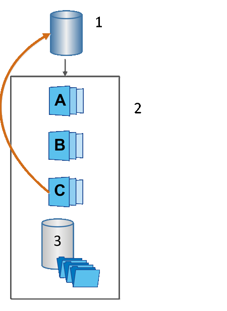

= SANtricity 소프트웨어의 스냅샷 롤백에 대해 알아보십시오
:allow-uri-read: 
:icons: font
:imagesdir: ../media/

[role="lead"]
롤백 작업은 선택한 스냅샷에 따라 기본 볼륨을 이전 상태로 되돌립니다.

롤백을 위해 다음 소스 중 하나에서 스냅샷 이미지를 선택할 수 있습니다.

* *스냅샷 이미지 롤백*: 기본 볼륨의 전체 복원을 위한 것입니다.
* *스냅샷 일관성 그룹 롤백*은 하나 이상의 볼륨을 롤백하는 데 사용할 수 있습니다.

롤백 중에 스냅샷 기능은 그룹의 모든 스냅샷 이미지를 보존합니다. 또한 필요한 경우 이 프로세스 중에 호스트가 I/O 작업을 위해 베이스 볼륨에 액세스할 수 있습니다.

롤백이 시작되면 백그라운드 프로세스가 기본 볼륨의 논리 블록 주소(LBA)를 스캔하여 복원할 롤백 스냅샷 이미지에서 쓰기 시 복사되는 데이터를 찾습니다. 기본 볼륨은 호스트에서 읽기 및 쓰기가 가능하고 이전에 기록된 모든 데이터를 즉시 사용할 수 있으므로 예약된 용량 볼륨은 롤백 처리 중에 모든 변경 사항을 저장할 수 있을 만큼 충분히 커야 합니다. 데이터 전송은 롤백이 완료될 때까지 백그라운드 작업으로 계속됩니다.

^1^ 기본 볼륨, ^2^ 그룹의 스냅샷 객체, ^3^ 스냅샷 그룹 예약된 용량
