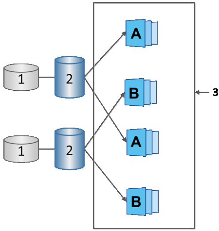

= SANtricity System Manager에서 스냅샷 일정 및 스냅샷 일관성 그룹에 대해 알아보십시오
:allow-uri-read: 
:icons: font
:imagesdir: ../media/

[role="lead"]
스냅샷 이미지 수집에는 스냅샷 일정을 사용하고, 여러 기본 볼륨 관리를 위해 스냅샷 일관성 그룹을 사용하십시오.

기본 볼륨의 스냅샷 작업을 간편하게 관리하려면 다음 기능을 사용할 수 있습니다.

* *스냅샷 일정* -- 단일 기본 볼륨에 대한 스냅샷을 자동화합니다.
* *스냅샷 일관성 그룹* -- 여러 기본 볼륨을 하나의 엔티티로 관리합니다.

== 스냅샷 일정

기본 볼륨에 대한 스냅샷을 자동으로 생성하려면 스냅샷 일정을 만들 수 있습니다. 예를 들어 매주 토요일 자정, 매월 1일 또는 원하는 날짜와 시간에 스냅샷 이미지를 생성하는 스냅샷 일정을 정의할 수 있습니다. 단일 스냅샷 일정에 대해 최대 32개의 스냅샷에 도달한 후에는 예약된 스냅샷을 일시 중지하거나 예약된 용량을 추가로 생성하거나 스냅샷을 삭제할 수 있습니다. 스냅샷은 수동으로 삭제하거나 삭제 프로세스를 자동화하여 삭제할 수 있습니다. 스냅샷 이미지가 삭제되면 추가 예약된 용량을 재사용할 수 있습니다.

== 스냅샷 일관성 그룹

여러 볼륨에 대해 동시에 스냅샷 이미지를 생성하려는 경우 스냅샷 일관성 그룹을 생성합니다. 스냅샷 이미지 작업은 스냅샷 일관성 그룹 전체에 대해 수행됩니다. 예를 들어, 모든 볼륨의 동기화된 스냅샷을 동일한 타임스탬프로 예약할 수 있습니다. 스냅샷 일관성 그룹은 로그를 한 볼륨에 저장하고 데이터베이스 파일을 다른 볼륨에 저장하는 데이터베이스 애플리케이션과 같이 여러 볼륨에 걸쳐 있는 애플리케이션에 적합합니다.

스냅샷 일관성 그룹에 포함된 볼륨을 멤버 볼륨이라고 합니다. 볼륨을 일관성 그룹에 추가하면 System Manager가 해당 멤버 볼륨에 대응하는 새 예약 용량을 자동으로 생성합니다. 각 멤버 볼륨의 스냅샷 이미지를 자동으로 생성하도록 일정을 정의할 수 있습니다.

^1^ 예약된 용량, ^2^ 구성원 볼륨, ^3^ 일관성 그룹 스냅샷 이미지
