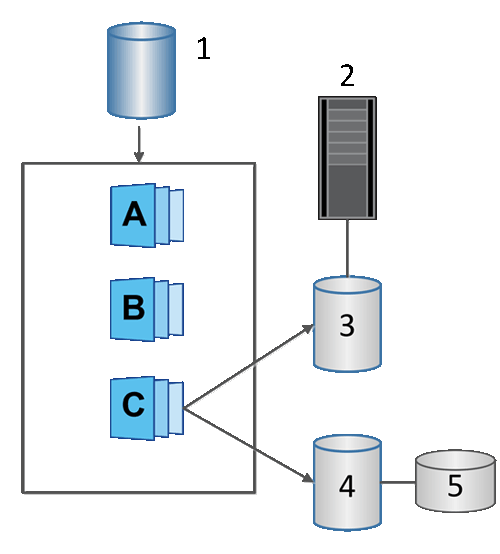

= SANtricity 소프트웨어의 스냅샷 볼륨에 대해 알아보십시오.
:allow-uri-read: 
:icons: font
:imagesdir: ../media/

[role="lead"]
스냅샷 데이터를 읽거나 쓰려면 스냅샷 볼륨을 생성하고 호스트에 할당할 수 있습니다. 스냅샷 볼륨은 기본 볼륨과 동일한 특성(RAID 레벨, I/O 특성 등)을 공유합니다.

스냅샷 볼륨을 생성할 때 읽기 전용 또는 읽기-쓰기 액세스 가능으로 지정할 수 있습니다.

읽기 전용 스냅샷 볼륨을 생성할 때는 예약 용량을 추가할 필요가 없습니다. 읽기/쓰기 스냅샷 볼륨을 생성할 때는 쓰기 액세스를 제공하기 위해 예약 용량을 추가해야 합니다.

^1^ 기본 볼륨, ^2^ 호스트, ^3^ 읽기 전용 스냅샷 볼륨, ^4^ 읽기-쓰기 스냅샷 볼륨, ^5^ 예약된 용량
